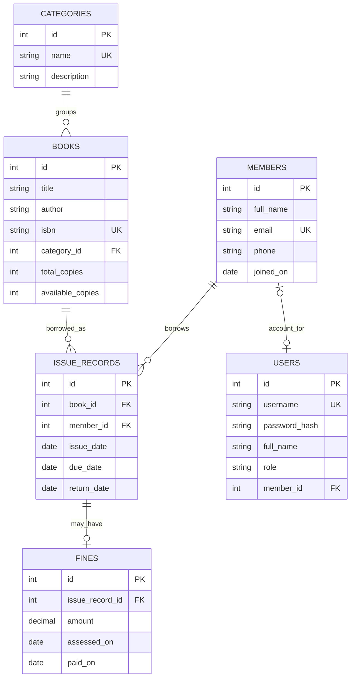
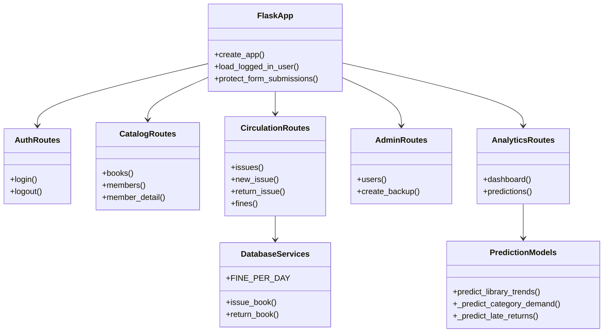
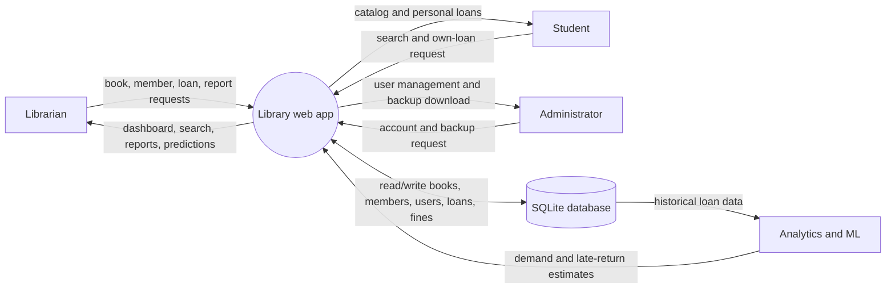
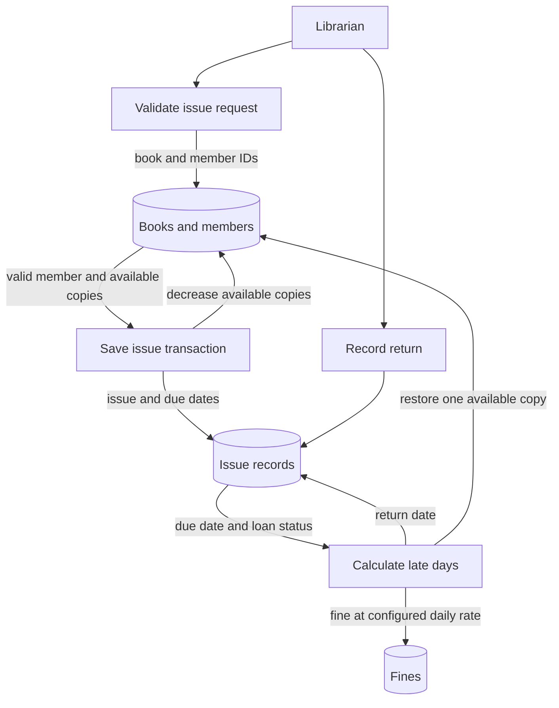

# System Diagrams

The Mermaid diagrams can be rendered by compatible Markdown viewers.

## ER diagram

## Class / module diagram

This project uses Flask modules and SQLite rows rather than a large object model.
The diagram shows the main responsibilities.

## Data-flow diagram (level 0)

## Data-flow diagram (circulation detail)

